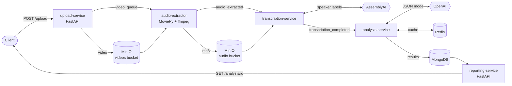

# Psychology Session Analyzer

An event-driven microservices backend that turns a recorded therapy session (video) into a structured psychological analysis: a session summary, the patient's **breakthrough moments** and **emotional triggers** with intensity scores.

Upload a video → the audio is extracted → transcribed with speaker separation (therapist / patient) → analyzed by an LLM → stored and served through a REST API. Every step is an independent worker connected through RabbitMQ, so each stage can be scaled, deployed and debugged on its own.

## Architecture



| Service | Role | Tech |
|---|---|---|
| `upload-service` | Accepts video uploads, stores them in object storage, publishes a job | FastAPI, MinIO, RabbitMQ |
| `audio-extractor` | Downloads the video and extracts an MP3 track | MoviePy, ffmpeg |
| `transcription-service` | Transcribes the audio with speaker diarization | AssemblyAI REST API |
| `analysis-service` | Detects breakthroughs and emotional triggers, caches results by transcript hash | OpenAI (JSON mode), Redis, MongoDB |
| `reporting-service` | Read-only API for finished analyses | FastAPI, MongoDB |

**Design choices**
- **Queue per stage** (`video_queue` → `audio_extracted` → `transcription_completed` → `analysis_completed`), durable queues and persistent messages, manual `ack` only after a stage succeeds, `prefetch_count=1` so a slow job never blocks a worker.
- **Claim-check pattern** – large files live in MinIO; only IDs and paths travel through the queue.
- **Idempotent writes** – results are upserted by `video_id`, and identical transcripts are served from the Redis cache instead of calling the LLM again.
- **Observability** – every service logs structured JSON; an optional Datadog agent collects logs from all containers.

## Getting started

**Requirements:** Docker with Docker Compose, an [AssemblyAI](https://www.assemblyai.com/) API key and an OpenAI API key.

```bash
git clone https://github.com/OfekZagury/Psychology-Session-Analyzer.git
cd Psychology-Session-Analyzer
cp .env.example .env        # add your API keys
docker compose up --build
```

Upload a session and fetch the result:

```bash
curl -F "file=@session.mp4" http://localhost:8000/upload
# → {"video_id": "...", "status": "processing_started"}

curl http://localhost:8001/analysis/<video_id>
curl http://localhost:8001/videos            # list all analyzed sessions
```

Interactive API docs: <http://localhost:8000/docs> (upload) and <http://localhost:8001/docs> (reporting).
Dashboards: RabbitMQ <http://localhost:15672>, MinIO <http://localhost:9001> (credentials from `.env`).

To also run the Datadog agent, set `DD_API_KEY` in `.env` and start with `docker compose --profile monitoring up`.

## Analysis output

The analysis service asks the model for this structure:

```json
{
  "participants": {"A": "Therapist", "B": "Patient"},
  "summary": "Brief summary of the session",
  "breakthroughs": [
    {"text": "exact quote", "insight_type": "Reframing / Realization / Acceptance",
     "intensity": "High/Medium", "analysis": "what the patient realized"}
  ],
  "emotional_triggers": [
    {"topic": "e.g. Work", "emotion": "e.g. Guilt", "intensity": 8,
     "text_segment": "exact quote", "analysis": "the trigger and the reaction"}
  ]
}
```

## Configuration

| Variable | Default | Purpose |
|---|---|---|
| `ASSEMBLYAI_API_KEY` | – | Transcription |
| `OPENAI_API_KEY` | – | Analysis |
| `OPENAI_MODEL` | `gpt-4o-mini` | Any chat model with JSON mode |
| `TRANSCRIPTION_LANGUAGE` | `en` | AssemblyAI language code of the session audio |
| `RABBITMQ_DEFAULT_USER` / `_PASS` | – | Broker credentials |
| `MINIO_ROOT_USER` / `_PASSWORD` | – | Object storage credentials |
| `DD_API_KEY` / `DD_SITE` | – | Optional Datadog monitoring |

## Tests

Unit tests for the analysis service use in-memory fakes for Redis, MongoDB, RabbitMQ and the LLM, so they need no containers or API keys:

```bash
cd services/analysis-service
pip install -r requirements.txt
python -m unittest discover tests
```

## Privacy note

Therapy recordings are highly sensitive. This project is a technical demo: use only synthetic or publicly available sessions, and do not send real patient data to third-party APIs.
